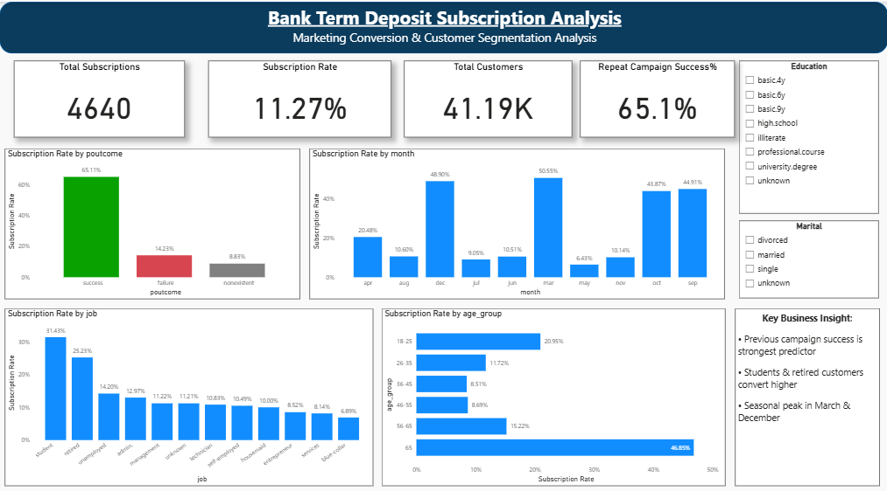
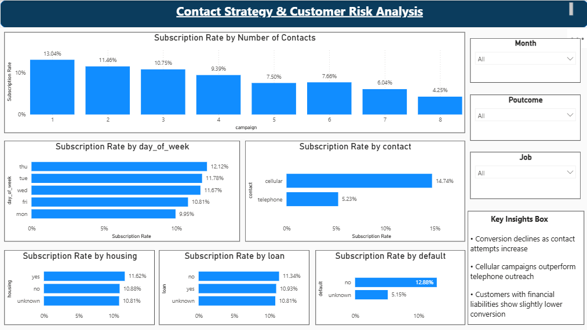

 <h1 align="center">📊 Bank Term Deposit Subscription Analysis</h1>

<p align="center">
  End-to-end Data Analytics project using Python, Machine Learning, and Power BI to analyze customer subscription behavior, campaign performance, and business opportunities.
</p>

<p align="center">
  
  
  
  
  
  
  
</p>

<p align="center">
  <a href="https://www.linkedin.com/in/mayur-bende/">
    
  </a>
  <a href="https://github.com/mayurbende607">
    
  </a>
</p>

---

## 📌 Project Overview

This project analyzes a bank marketing dataset to understand the factors associated with customers subscribing to a term deposit.

The project follows an end-to-end workflow covering data preparation, exploratory data analysis (EDA), machine learning, business insights, and interactive Power BI dashboarding.

## 🎯 Business Problem

Banks invest in direct marketing campaigns to promote term deposits, but subscription rates can be relatively low.

This project aims to:

- Identify customer and campaign characteristics associated with subscription.
- Analyze customer segments and previous campaign outcomes.
- Evaluate campaign contact patterns and performance.
- Compare machine learning models for predicting term deposit subscription.
- Translate analytical findings into actionable business recommendations.

## 🗂 Dataset Summary

- **Original records:** 41,188
- **Features:** 20 input features and 1 target variable
- **Target variable:** `y` — term deposit subscription (`yes` or `no`)
- **Records after duplicate removal:** 41,176

The dataset contains customer demographics, campaign contact information, previous campaign outcomes, and economic indicators.

## 🛠 Tools & Technologies

- **Python** — data analysis and machine learning
- **Pandas & NumPy** — data manipulation and preparation
- **Matplotlib & Seaborn** — data visualization
- **Scikit-learn** — machine learning and model evaluation
- **Power BI** — interactive dashboards
- **Jupyter Notebook** — analysis workflow

## 🔍 Project Workflow

### 1. Data Preparation

- Inspected dataset structure and data types.
- Checked missing values, duplicate records, and categorical values.
- Removed duplicate records.
- Retained meaningful dataset values such as `unknown` and `pdays = 999` for analysis.

### 2. Exploratory Data Analysis

Analyzed the target variable and customer characteristics to understand subscription patterns and class imbalance.

### 3. Bivariate Analysis

Examined subscription rates across:

- Age groups and job categories
- Education and marital status
- Contact type and campaign month
- Campaign contact frequency
- Housing loans, personal loans, and default status
- Previous campaign outcomes

### 4. Multivariate Analysis

Explored combined patterns involving:

- Age group × job category
- Education × job category
- Previous campaign outcome × age group

### 5. Correlation Analysis

Examined relationships among numerical variables, including economic indicators and campaign-related attributes.

### 6. Machine Learning

Built and compared three classification models:

- Logistic Regression
- Decision Tree
- Random Forest

Evaluated model performance using accuracy, precision, recall, and F1-score, with particular attention to the minority `yes` class.

### 7. Power BI Dashboard

Created a two-page interactive dashboard:

- **Page 1:** Executive Overview
- **Page 2:** Contact Strategy & Customer Risk Analysis

## 📊 Dashboard Preview

### Page 1 — Executive Overview

<p align="center">
  
</p>

### Page 2 — Contact Strategy & Customer Risk Analysis

<p align="center">
  
</p>

## 💡 Key Insights

- Approximately **11.27%** of customers subscribed to a term deposit, indicating an imbalanced target variable.
- Customers with a successful previous campaign outcome had a substantially higher historical subscription rate than customers with a previous failure or no previous campaign outcome.
- Subscription rates varied across age groups, job categories, and education levels.
- Cellular contact showed a higher historical subscription rate than telephone contact.
- Higher campaign contact frequency was associated with lower subscription rates.
- Campaign performance varied by month, with March and December showing comparatively strong subscription patterns in the analysis.

*These findings describe historical associations in the dataset and do not establish causation.*

## 🤖 Machine Learning Results

The models achieved the following accuracy scores in the notebook:

| Model | Accuracy |
|---|---:|
| Logistic Regression | 91.07% |
| Decision Tree | 91.50% |
| Random Forest | 91.20% |

The Decision Tree achieved the highest accuracy among these three models in this evaluation.

However, accuracy alone is insufficient because only about 11.27% of customers subscribed. Precision, recall, and F1-score for the `yes` class are also important when assessing how well a model identifies potential subscribers.

## 📈 Business Recommendations

- Prioritize analysis of customers with successful previous campaign outcomes.
- Use customer segmentation to support more focused marketing strategies.
- Review campaign contact frequency to reduce potentially inefficient repeated contacts.
- Investigate seasonal patterns when planning future campaigns.
- Evaluate contact channels using subscription rates and campaign performance.
- Use machine learning results as decision support rather than as a guarantee of customer behavior.

## 📁 Repository Structure

```text
Bank-Term-Deposit-Analysis/
│
├── Bank_Term_Deposit_EDA_ML.ipynb
├── Bank_Term_Deposit_Dashboard.pbix
├── Bank_Term_Deposit_Report.pdf
├── dashboard_page1.png
├── dashboard_page2.png
├── bank.xlsx
└── README.md
```

## 🚀 How to Explore the Project

1. Open `Bank_Term_Deposit_EDA_ML.ipynb` to explore the data preparation, EDA, and machine learning workflow.
2. Open the dashboard preview images to view the main Power BI visuals.
3. Open `Bank_Term_Deposit_Dashboard.pbix` in Power BI Desktop to explore the interactive dashboard.
4. Refer to `Bank_Term_Deposit_Report.pdf` for the project report.

## 🔮 Future Improvements

- Improve model evaluation and recall for the minority subscription class.
- Explore hyperparameter tuning and additional evaluation techniques.
- Develop an interactive application for exploring model predictions.

## 👤 Author

**Mayur Bende**

- LinkedIn: [linkedin.com/in/mayur-bende](https://www.linkedin.com/in/mayur-bende/)
- GitHub: [github.com/mayurbende607](https://github.com/mayurbende607)

---

*This project demonstrates practical skills in data analysis, visualization, machine learning, and business-focused insight generation.*
